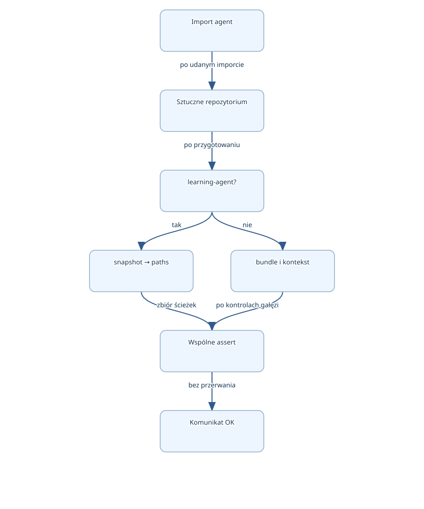

# Jak skrypt sprawdza wybór plików dla dwóch agentów

Commit: `5f0023185cec49664718df16f27f367a412e3619` · gałąź: `master` · 2026-10-28T23:36:07.632704+00:00

Analiza statyczna. Przygotowano materiał; nie potwierdzono przeczytania ani zrozumienia.

tools/tests/check_rust_selection.py to pomocniczy skrypt Pythona, który przygotowuje sztuczne repozytorium i sprawdza wybieranie źródeł przez nauczyciela kodu oraz agenta prawnego. Oczekuje uwzględnienia plików Rust i Cargo oraz pominięcia wskazanych plików generowanych i nazw sugerujących sekrety. Lekcja obejmuje cały plik na podstawie analizy statycznej; skrypt nie został uruchomiony. Migawka: master, commit 5f0023185cec49664718df16f27f367a412e3619, data analizy 2026-10-29, Europe/Warsaw.

## Związek z planem aplikacji

**Cel:** docs/APP_PLAN.md podaje cel: eksperyment BM25 w Rust i możliwość późniejszego wykorzystania w XREALPresentation. Format danych, indeksowanie, pomiary oraz ewentualna integracja wymagają dalszych ustaleń.

**Rola teraz:** Omawiany skrypt sprawdza narzędzia pomocnicze przygotowujące materiały dla agentów. Nie implementuje wyszukiwania BM25. Jego przypadki kontrolne dotyczą tego, jakie pliki trafiają do migawki lub zestawu materiałów.

**Pozostały zakres:** W odniesieniu do skryptu brakuje w migawce implementacji importowanych agentów i wyniku wykonania kontroli. W odniesieniu do planu aplikacji nadal pozostają do ustalenia wejście, tokenizacja i wyniki; obecny main tylko wypisuje komunikat.

**Niepewności:** Plan nie określa osobnych wymagań odbioru dla tego skryptu, więc jego zachowania opisano jako obecną implementację. docs/PROJECT_STATUS.md odnosi przegląd do wcześniejszego commitu 5ed8c12197b6a491a3fab8debf3aa12d8f79246b; nie jest wynikiem weryfikacji analizowanej migawki. Aktywnych zadań ani dokumentu DECISIONS nie dostarczono.

Plan / ustalenia: `docs/APP_PLAN.md` — Plan roboczy: Zapisuje cel eksperymentu BM25, proponowane etapy wymagające ustalenia i brak istniejącej integracji.

Plan / ustalenia: `docs/PROJECT_STATUS.md` — Implementacja i weryfikacja: Rozdziela obecny komunikat w main od planowanego indeksowania i rankingu; podaje też brak wykonanych buildów i testów w opisanym przeglądzie.

Implementacja: `tools/tests/check_rust_selection.py` — select: Zmienna wskazuje a.is_source albo a.candidate. Końcowe pętle sprawdzają wynik wyboru oraz obecność ścieżek w przygotowanych materiałach.

Implementacja: `src/main.rs` — main: Ciało funkcji zawiera tylko println!("Hello, world!"); nie realizuje etapów BM25.

## Plik: `tools/tests/check_rust_selection.py`

Pełny przebieg skryptu: uruchamianie osobnych procesów, wybór modułu agent, tworzenie sztucznego repozytorium, dwie gałęzie przygotowania materiałów i kontrole końcowe. SHA-256 według manifestu: 6019acfa772b7122a18a0113bdad27f0271250ebe2bb97397059cb294b69a108.

Zakres: full. Brak pominiętego zakresu tego pliku. Wewnętrzne implementacje importowanych agentów nie są częścią dostępnej migawki.

### Metoda `git`

Źródło: `tools/tests/check_rust_selection.py`

**Kiedy:** Wywoływana przez kod wewnątrz bloku TemporaryDirectory podczas przygotowania repozytorium i odczytu identyfikatora commitu.

**Wejście:** Dowolna liczba argumentów polecenia, np. 'init', '-q'. Korzysta też ze zmiennej tmp z otaczającego zakresu.

**Działanie:** Uruchamia git z opcją -C wskazującą katalog tymczasowy. Przechwytuje standardowe wyjście, zamienia bajty na tekst i usuwa białe znaki z jego początku i końca. Poszczególne wywołania mogą tworzyć repozytorium, dodawać pliki i wykonywać commit.

**Wynik/skutki:** Tekst standardowego wyjścia. Niezerowy kod zakończenia polecenia powoduje wyjątek zamiast zwrócenia tekstu.

## Plik pomocniczy napisany w Pythonie

Źródło: `tools/tests/check_rust_selection.py` — ROOT

Ten plik należy do narzędzi projektu Rust, ale sam jest kodem Pythona. pathlib, subprocess, sys i tempfile pochodzą z biblioteki standardowej Pythona. agent jest modułem projektu wybieranym później przez ścieżkę importowania. Większość pracy znajduje się bezpośrednio na poziomie pliku, więc rozpoczyna się przy jego wykonaniu. Jedyną własną zdefiniowaną funkcją jest git; zewnętrznego wywołującego skrypt nie ustalono.

````python
ROOT = pathlib.Path(__file__).resolve().parents[2]
````

__file__ wskazuje plik skryptu. Path tworzy obiekt ścieżki, resolve wyznacza ścieżkę bezwzględną z rozwiązaniem dowiązań, a parents[2] wybiera trzeci katalog nadrzędny: dla tools/tests/check_rust_selection.py jest nim katalog główny projektu. ROOT służy następnie do znalezienia katalogu wybranego narzędzia.

## Bez argumentu: dwa kolejne procesy

Źródło: `tools/tests/check_rust_selection.py` — tool

sys.argv zawiera nazwę uruchamianego skryptu i przekazane argumenty. Gdy lista ma jeden element, skrypt uruchamia swoją kopię najpierw z argumentem learning-agent, a później legal-agent. Każda kopia ma własny interpreter i własny stan importów. Wywołanie run czeka na zakończenie procesu; nie ma tu równoległego wykonania. Jeśli pierwszy proces zgłosi błąd, check=True przerwie tę ścieżkę przed uruchomieniem drugiego.

````python
if len(sys.argv) == 1:
    for tool in ('learning-agent', 'legal-agent'):
        subprocess.run([sys.executable, __file__, tool], check=True)
    sys.exit()
````

sys.executable wskazuje bieżący interpreter. Lista przekazuje mu plik skryptu i nazwę narzędzia jako oddzielne argumenty. sys.exit() kończy proces nadrzędny po zakończeniu obu wywołań, dzięki czemu nie przechodzi on do części wymagającej sys.argv[1].

## Z argumentem: wybór modułu agent

Źródło: `tools/tests/check_rust_selection.py` — a

Proces z argumentem pobiera nazwę narzędzia, umieszcza jego katalog na początku miejsc przeszukiwanych przy imporcie i ładuje moduł agent pod krótką nazwą a. Dzięki oddzielnym procesom dwa narzędzia mogą mieć moduły o tej samej nazwie bez współdzielenia pamięci importów. Skrypt nie sprawdza listy dozwolonych argumentów: każda wartość inna niż learning-agent trafia później do gałęzi else, o ile wcześniejszy import się powiedzie.

````python
tool = sys.argv[1]
sys.path.insert(0, str(ROOT / 'tools' / tool))
import agent as a
````

Operator / na obiektach Path łączy części ścieżki. str daje tekst wymagany w sys.path. insert(0, ...) nadaje katalogowi pierwszeństwo wyszukiwania, a as a wprowadza skrót używany w wywołaniach a.Repo, a.install i pozostałych funkcji projektu. Import może wykonywać kod modułu; jego treści tutaj nie dostarczono.

## Sztuczne repozytorium jako wejście kontroli

Źródło: `tools/tests/check_rust_selection.py` — git

TemporaryDirectory udostępnia osobny katalog na czas bloku with. Skrypt tworzy w nim małe repozytorium z plikami dopuszczanymi i odrzucanymi: źródłem Rust, plikami Cargo, plikami pod target, nazwami sugerującymi sekrety i planem. Wartości DO_NOT_READ są sztucznymi znacznikami, a nie odczytanymi poświadczeniami. Pętla tworzy potrzebne katalogi i zapisuje treści. Następnie git add oraz git commit przygotowują commit do pobierania migawki; opcje -c podają tożsamość dla tego polecenia. To opis skutków uruchomienia skryptu, nie czynności wykonane podczas lekcji.

````python
with tempfile.TemporaryDirectory() as tmp:
    root = pathlib.Path(tmp)
    def git(*args):
        return subprocess.check_output(['git', '-C', tmp, *args]).decode().strip()
    git('init', '-q')
````

Wcięcia wyznaczają blok katalogu tymczasowego i ciało funkcji. W definicji *args zbiera argumenty w jedną krotkę; w liście polecenia *args rozkłada je na kolejne elementy. check_output zwraca bajty standardowego wyjścia, decode zamienia je na tekst, a strip usuwa skrajne białe znaki. Późniejsze a.Repo(root) otrzymuje ścieżkę tego sztucznego repozytorium.

## Gałąź nauczyciela: sprawdzenie migawki

Źródło: `tools/tests/check_rust_selection.py` — manifest

Dla learning-agent skrypt wywołuje a.install z no_hook=True, przypisuje a.is_source do select i tworzy kopię słownika a.DEFAULTS. W konfiguracji plan_files celowo umieszcza zarówno plan, jak i ścieżki mające zostać odrzucone. Tworzy katalog snapshot i przekazuje do a.snapshot repozytorium, commit, nazwę gałęzi test, listę z src/main.rs oraz konfigurację. Zwrócony manifest służy do zbudowania zbioru paths. Końcowe kontrole oczekują w nim również Cargo.toml i Cargo.lock, mimo że jawna lista wejściowa zawiera tylko src/main.rs.

````python
manifest = a.snapshot(repo, {'commit': git('rev-parse', 'HEAD'), 'branch': 'test'},
                              ['src/main.rs'], folder, cfg)
        paths = {x['path'] for x in manifest['snapshot_files']}
````

Słownik z commit i branch opisuje żądaną migawkę; tekst 'test' jest argumentem, nie dowodem utworzenia takiej gałęzi Git. Z każdego wpisu snapshot_files pobierane jest pole path. Zbiór zachowuje informację o obecności ścieżek, ale nie o ich kolejności ani liczbie powtórzeń. Wewnętrznego działania snapshot i install nie można ustalić z samego wywołania.

## Gałąź prawna: pakiet, kontekst i jawne żądanie

Źródło: `tools/tests/check_rust_selection.py` — a.enqueue

W gałęzi else skrypt wywołuje a.install z timer=False, pobiera konfigurację, ustawia refresh_sources i auto_open na False, a następnie ją zapisuje przez a.save. select wskazuje tutaj a.candidate. a.enqueue tworzy identyfikator zadania baseline, a.load odczytuje jego dane, a a.build_bundle otrzymuje repozytorium, zadanie i jego targets. Z pola files budowany jest zbiór paths. Potem skrypt dodaje dwie ścieżki do a.CONTEXT_PATHS i sprawdza, że nie trafiają do wyniku a.context(repo)[0]. Osobno sprawdza jawne żądanie dodania target/generated.rs.

````python
try:
            a.enqueue(repo, 'baseline', files=['target/generated.rs'], manual=True)
        except RuntimeError:
            pass
        else:
            raise AssertionError('explicit target accepted')
````

Oczekiwanym przebiegiem jest RuntimeError, który zostaje przechwycony. pass oznacza brak dalszej czynności w tej obsłudze. else należące do try wykona się, jeśli wywołanie nie zgłosi wyjątku; wtedy skrypt sam zgłasza AssertionError. Inny rodzaj wyjątku nie zostanie tu przechwycony. Skrypt nie sprawdza treści RuntimeError, więc sam ten fragment nie potwierdza przyczyny odrzucenia.

## Wspólne kontrole i znaczenie komunikatu OK

Źródło: `tools/tests/check_rust_selection.py` — select

Obie gałęzie kończą się tymi samymi kontrolami. Dla trzech plików skrypt wymaga zarówno pozytywnego wyniku select, jak i obecności w paths. Dla pięciu pozostałych wymaga odrzucenia przez select oraz nieobecności w paths. Są to dwa poziomy kontroli: decyzja funkcji i wynik przygotowania materiałów. print wypisuje komunikat dopiero po dotarciu do końca; nie zwraca raportu ani liczby zaliczonych przypadków.

````python
for name in ('src/main.rs', 'Cargo.toml', 'Cargo.lock'):
        assert select(name), name
        assert name in paths, (name, paths)
    for name in ('target/generated.rs', 'nested/target/Cargo.toml', '.env', 'credentials.json', 'private-key.rs'):
        assert not select(name), name
        assert name not in paths, name
````

assert sprawdza warunek; po przecinku podano dane pomocne w diagnozie niepowodzenia. not odwraca wartość logiczną, a in bada przynależność do zbioru. Niepowodzenie zatrzymuje bieżący proces wyjątkiem AssertionError. Kontrole dotyczą wymienionych nazw, więc nie dowodzą wykrywania wszystkich możliwych sekretów. Przy uruchomieniu Pythona z optymalizacją instrukcje assert mogą zostać pominięte; jawne raise AssertionError w poprzedniej sekcji pozostaje osobnym mechanizmem.

## Nowe pojęcie: Osobny proces interpretera

Klucz: `python.subprocess.separate-interpreter`

Program może uruchomić drugi program z własną pamięcią. Tutaj subprocess.run uruchamia nowy interpreter Pythona dla każdego narzędzia.

Oba narzędzia importują moduł o nazwie agent. Osobne procesy oddzielają ich pamięć importów i zmienne modułów.

````
subprocess.run([sys.executable, 'check.py', 'learning-agent'], check=True)
````

Przykład pomocniczy: uruchamia check.py w bieżącym interpreterze jako nowy proces, przekazuje argument i czeka na koniec. Niezerowy kod zakończenia powoduje wyjątek.

**Częste nieporozumienie:** Osobny proces nie oznacza równoległości ani pełnej izolacji systemu plików. W skrypcie procesy uruchamiane są kolejno.

## Nowe pojęcie: Katalog tymczasowy zarządzany przez with

Klucz: `python.tempfile.temporary-directory-context`

Kod otrzymuje katalog do pracy, a zarządzający nim obiekt sprząta go przy opuszczeniu bloku with w zwykłym przebiegu i podczas obsługi wyjątków.

Sztuczne pliki i repozytorium mogą służyć jako dane kontroli bez tworzenia ich w źródłach aplikacji.

````
with tempfile.TemporaryDirectory() as tmp:
    root = pathlib.Path(tmp)
````

Przykład pomocniczy: tmp jest tekstem ścieżki, a root obiektem ułatwiającym operacje na niej. Wcięcie określa czas korzystania z katalogu.

**Częste nieporozumienie:** with nie ogranicza uprawnień wywoływanych funkcji do tego katalogu. Bez kodu agentów nie można potwierdzić wszystkich miejsc ich zapisu.

## Nowe pojęcie: Wybór modułu przez ścieżkę importowania

Klucz: `python.import.search-path-selection`

sys.path określa miejsca szukania modułów. Dodanie katalogu na początku listy pozwala wskazać, skąd ma zostać znaleziony moduł o danej nazwie.

Skrypt używa tej samej nazwy agent dla dwóch narzędzi znajdujących się w różnych katalogach.

````
sys.path.insert(0, '/example/tools/learning-agent')
import agent as a
````

Przykład pomocniczy: katalog otrzymuje pierwszeństwo wyszukiwania, a a staje się skrótem dla zaimportowanego modułu.

**Częste nieporozumienie:** Zmiana sys.path nie zastępuje automatycznie modułu już zapamiętanego przez interpreter. W tej lekcji osobne procesy oddzielają importy.

## Nowe pojęcie: Zbiór ścieżek i sprawdzanie obecności

Klucz: `python.set.comprehension-membership-intersection`

Zbiór przechowuje niepowtarzające się elementy. Zapis z for wewnątrz klamer tworzy go z kolejnych wartości, in sprawdza obecność, a & znajduje elementy wspólne.

Kontrola potrzebuje wiedzieć, czy dana ścieżka trafiła do materiałów, bez zależności od kolejności wpisów.

````
paths = {x['path'] for x in [{'path': 'src/main.rs'}, {'path': 'Cargo.toml'}]}
blocked = {'target/generated.rs', '.env'}
common = blocked & paths
````

Przykład pomocniczy: paths zawiera dwie ścieżki. common jest pustym zbiorem, bo żadna zabroniona ścieżka nie występuje w paths. Pusty zbiór ma wartość logiczną fałszu, stąd assert not common sprawdza brak przecięcia.

**Częste nieporozumienie:** Zbiór usuwa powtórzenia. Taka kontrola nie wykryje, że manifest zawiera dwa wpisy tej samej ścieżki.

## Nowe pojęcie: Sprawdzenie warunku i oczekiwanego wyjątku

Klucz: `python.testing.assert-and-expected-exception`

assert przerywa wykonanie, gdy warunek nie jest spełniony. try/except/else pozwala osobno sprawdzić sytuację, w której wywołanie powinno zgłosić określony wyjątek.

Skrypt sprawdza zarówno obecność i nieobecność plików, jak i odrzucenie jawnego żądania zabronionego pliku.

````
try:
    operation()
except RuntimeError:
    pass
else:
    raise AssertionError('expected rejection')
````

Przykład pomocniczy: RuntimeError jest oczekiwanym wynikiem. Brak wyjątku powoduje jawne niepowodzenie. Inny wyjątek przechodzi dalej.

**Częste nieporozumienie:** Przechwycenie samego typu wyjątku nie dowodzi jego przyczyny. Instrukcje assert mogą też zostać wyłączone przez optymalizację interpretera.

## Przepływ jednego uruchomienia z argumentem



Diagram przedstawia kolejność wynikającą z instrukcji skryptu dla procesu z argumentem. Bez argumentów proces nadrzędny uruchamia dwa takie przebiegi kolejno. Pominięto krawędzie błędów: wyjątek może przerwać wykonanie przed komunikatem. Nie przedstawiono nieznanych wnętrz funkcji agentów.

## Następny krok

Prześledź bez uruchamiania parę kontroli dla Cargo.lock: co sprawdza select(name), a co name in paths? W następnej lekcji warto przeczytać implementacje is_source i candidate po udostępnieniu ich w migawce.

## Ograniczenia

- Wykonano wyłącznie odczyt migawki i analizę statyczną. Nie uruchomiono skryptu, Git, agentów, aplikacji, testów ani instalacji; nie ma wyniku potwierdzającego przejście kontroli.
- Gałąź, commit i hash pliku podano z SOURCE_MANIFEST.json. Migawki nie traktowano jako aktywnego katalogu Git; stanu indeksu i zmian roboczych oryginalnego repozytorium nie ustalono.
- Brakuje implementacji tools/learning-agent/agent.py i tools/legal-agent/agent.py. Nie ustalono wewnętrznego działania ich funkcji, pełnych skutków ubocznych install ani gwarancji działania bez sieci. Nagłówek skryptu deklaruje kontrole offline, lecz sam nie stanowi ich dowodu.
- Nie ustalono zewnętrznego wywołującego skrypt ani konfiguracji uruchomienia Pythona, w tym ewentualnego wyłączenia assert.
- Przypadki sprawdzają konkretne nazwy i obecność ścieżek. Nie dowodzą, że wykluczone pliki nigdy nie zostały odczytane, że treść materiałów jest poprawna ani że wszystkie możliwe nazwy sekretów zostaną odrzucone.
- Brak aktywnych zadań i dokumentu DECISIONS w migawce. Część odnośników kontekstowych prowadzi do niedostarczonych materiałów, m.in. docs/AGENT_SETUP.md i STUDY_PLAN.md; nie użyto ich jako dowodów.
- Pamięć lekcji jest pusta. Przygotowanie tej lekcji i ćwiczeń nie potwierdza ich przeczytania ani zrozumienia przez autora.

## Sprawdź się — najpierw bez podglądania

Najpierw spróbuj odpowiedzieć z pamięci, bez zaglądania do opisu. Odpowiedz na głos lub na kartce. Przy pytaniach wyboru uzasadnij swój wybór przed otwarciem rozwiązań. W razie trudności wróć do krótkiego fragmentu i spróbuj ponownie.

### Pytanie 1 — Wyjaśnij własnymi słowami

Dlaczego dla Cargo.lock skrypt sprawdza zarówno select(name), jak i name in paths? Wyjaśnij własnymi słowami, co wnosi każda kontrola.

Źródło: `tools/tests/check_rust_selection.py` — select


### Pytanie 2 — Wskaż ograniczenia

Czy pomyślne przejście kontroli dla .env wystarczyłoby, aby stwierdzić, że agent nigdy nie odczytuje sekretów? Uzasadnij zakres takiego wniosku.

Źródło: `tools/tests/check_rust_selection.py` — paths


### Pytanie 3 — Przewidź działanie

Załóż zwykłe uruchomienie Pythona bez optymalizacji. W gałęzi prawnej a.enqueue wywołane wewnątrz try kończy się bez wyjątku. Co stanie się dalej i czy skrypt dotrze do końcowego print?

Źródło: `tools/tests/check_rust_selection.py` — a.enqueue


### Pytanie 4 — Przewidź działanie

Uruchomiono skrypt bez dodatkowych argumentów. Załóż, że proces learning-agent kończy się kodem 1. Co zrobi proces nadrzędny?

Źródło: `tools/tests/check_rust_selection.py` — tool

Fragment źródła

````python
subprocess.run([sys.executable, __file__, tool], check=True)
````

- **A.** Uruchomi legal-agent, a potem zgłosi błąd pierwszego procesu.
- **B.** Zgłosi wyjątek i nie uruchomi legal-agent.
- **C.** Ponowi learning-agent i po sukcesie uruchomi legal-agent.

### Pytanie 5 — Porównaj

Manifest zawiera dwa wpisy o path równym src/main.rs. Co o tych wpisach zachowa pokazane wyrażenie?

Źródło: `tools/tests/check_rust_selection.py` — paths

Fragment źródła

````python
paths = {x['path'] for x in manifest['snapshot_files']}
````

- **A.** Jedną ścieżkę, bez informacji o liczbie jej wystąpień.
- **B.** Dwa oddzielne elementy w kolejności z manifestu.
- **C.** Błąd informujący o powtórzeniu ścieżki.

## Odpowiedzi i wyjaśnienia

Najpierw odpowiedz samodzielnie. Nie każdy czytnik Markdown zwija rozwiązania.

<details>
<summary>Rozwiązanie pytania 1</summary>

### Pytanie 1

Dlaczego dla Cargo.lock skrypt sprawdza zarówno select(name), jak i name in paths? Wyjaśnij własnymi słowami, co wnosi każda kontrola.

**Przykładowa odpowiedź:**

select(name) sprawdza, czy funkcja wyboru dopuszcza Cargo.lock. name in paths sprawdza, czy plik rzeczywiście jest wymieniony w przygotowanych materiałach. Funkcja może dopuszczać plik, a dalsze przygotowanie materiałów może go pominąć, dlatego potrzebne są obie kontrole.

**Dlaczego?**

select wskazuje funkcję wybranego agenta, natomiast paths powstaje z manifestu migawki albo pakietu. To dwa różne etapy.

Porównaj sens, nie identyczne sformułowania:

- select sprawdza decyzję funkcji wyboru.
- paths opisuje wynik przygotowania materiałów.
- Pozytywna decyzja nie gwarantuje obecności w wyniku.

</details>

<details>
<summary>Rozwiązanie pytania 2</summary>

### Pytanie 2

Czy pomyślne przejście kontroli dla .env wystarczyłoby, aby stwierdzić, że agent nigdy nie odczytuje sekretów? Uzasadnij zakres takiego wniosku.

**Przykładowa odpowiedź:**

Nie. Kontrole pokazują odrzucenie konkretnej nazwy i jej brak na liście materiałów. Nie śledzą wszystkich odczytów plików i nie obejmują każdej możliwej nazwy ani treści sekretu. Są użyteczne jako kontrola znanych przypadków, ale nie wystarczają do ogólnej gwarancji poufności.

**Dlaczego?**

Skrypt bada wyniki select i zbiory ścieżek; nie zawiera obserwatora operacji odczytu. Implementacji agentów również nie ma w migawce.

Porównaj sens, nie identyczne sformułowania:

- Kontrola dotyczy konkretnego przypadku.
- Nieobecność w materiale nie dowodzi braku odczytu.
- Brak podstaw do gwarancji dla wszystkich sekretów.

</details>

<details>
<summary>Rozwiązanie pytania 3</summary>

### Pytanie 3

Załóż zwykłe uruchomienie Pythona bez optymalizacji. W gałęzi prawnej a.enqueue wywołane wewnątrz try kończy się bez wyjątku. Co stanie się dalej i czy skrypt dotrze do końcowego print?

**Przykładowa odpowiedź:**

Wykona się blok else należący do try i zgłosi AssertionError z komunikatem explicit target accepted. Ponieważ w tym pliku nic go dalej nie przechwytuje, bieżący proces zostanie przerwany i nie dotrze do końcowego print.

**Dlaczego?**

Brak wyjątku jest tutaj niepowodzeniem kontroli, ponieważ skrypt oczekuje odrzucenia jawnie wskazanego pliku.

Porównaj sens, nie identyczne sformułowania:

- Brak wyjątku uruchamia else.
- else jawnie zgłasza AssertionError.
- Proces nie dochodzi do komunikatu OK.

</details>

<details>
<summary>Rozwiązanie pytania 4</summary>

### Pytanie 4

Uruchomiono skrypt bez dodatkowych argumentów. Załóż, że proces learning-agent kończy się kodem 1. Co zrobi proces nadrzędny?

Fragment źródła

````python
subprocess.run([sys.executable, __file__, tool], check=True)
````

**Właściwa odpowiedź:**

Zgłosi wyjątek i nie uruchomi legal-agent.

**Dlaczego?**

Pierwsza iteracja pętli czeka na proces learning-agent. Kod 1 powoduje wyjątek z subprocess.run, więc kolejna iteracja nie nastąpi.

- **Uruchomi legal-agent, a potem zgłosi błąd pierwszego procesu.** — odpowiedź niepoprawna. Kod nie odkłada błędu do końca pętli; check=True powoduje wyjątek od razu po nieudanym procesie.
- **Zgłosi wyjątek i nie uruchomi legal-agent.** — odpowiedź poprawna. To poprawne: niezerowy kod zakończenia przy check=True przerywa pętlę wyjątkiem.
- **Ponowi learning-agent i po sukcesie uruchomi legal-agent.** — odpowiedź niepoprawna. W skrypcie nie ma mechanizmu ponawiania.

</details>

<details>
<summary>Rozwiązanie pytania 5</summary>

### Pytanie 5

Manifest zawiera dwa wpisy o path równym src/main.rs. Co o tych wpisach zachowa pokazane wyrażenie?

Fragment źródła

````python
paths = {x['path'] for x in manifest['snapshot_files']}
````

**Właściwa odpowiedź:**

Jedną ścieżkę, bez informacji o liczbie jej wystąpień.

**Dlaczego?**

Wyrażenie pobiera wartości path i umieszcza je w zbiorze. Dlatego późniejsze kontrole przynależności nie wykryją powtórzonych wpisów manifestu.

- **Jedną ścieżkę, bez informacji o liczbie jej wystąpień.** — odpowiedź poprawna. To poprawne: zbiór przechowuje unikalne wartości.
- **Dwa oddzielne elementy w kolejności z manifestu.** — odpowiedź niepoprawna. Tak mogłaby działać lista, lecz użyte klamry tworzą zbiór.
- **Błąd informujący o powtórzeniu ścieżki.** — odpowiedź niepoprawna. Tworzenie zbioru usuwa powtórzenia bez zgłaszania takiego błędu.

</details>

### Wróć do tego później

Po porównaniu odpowiedzi nazwij jedną rzecz, którą rozumiesz, i jedną do powtórzenia. Możesz wrócić do tych pytań jutro, za kilka dni i po tygodniu, najpierw odpowiadając z pamięci. To propozycja rytmu, bez automatycznego harmonogramu. Krótka przerwa i późniejsza próba są w porządku.

Ćwiczenie nie zapisuje wyniku i nie potwierdza opanowania materiału.
